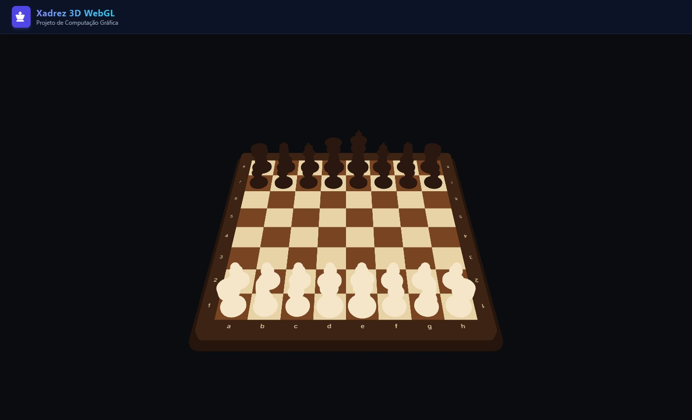
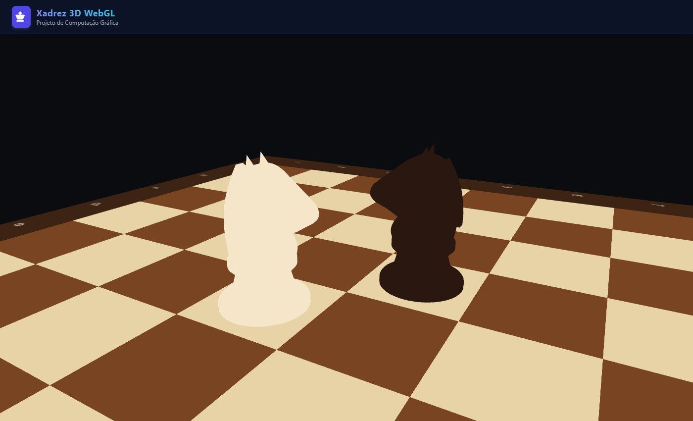

# ♟️ Xadrez 3D em WebGL2


Primeira entrega do jogo de xadrez 3D da disciplina de **Computação Gráfica**: **modelagem 3D e
construção da cena inicial**. O tabuleiro e as 32 peças aparecem na posição inicial de uma partida,
vistos por uma câmera fixa.





## Tecnologia

**Three.js r128 sobre WebGL2**, com módulos ES nativos e `importmap` (sem build).

## Personagem: o cavalo

O personagem complexo é o **cavalo**, modelado em código pelo grupo (**nenhum modelo externo foi
usado**). Ele é um `THREE.Group` com **12 malhas**:

- **Corpo:** sólido de revolução (`LatheGeometry`): uma lista de pontos `[raio, altura]`, com arcos
  para as partes arredondadas, girada em torno do eixo Y.
- **Cabeça:** silhueta lateral desenhada com um `Shape` (retas e curvas de Bézier para peito,
  mandíbula, focinho, testa e nuca), extrudada com chanfro (`ExtrudeGeometry`) e girada 90° para olhar
  para o adversário.
- **Detalhes:** duas orelhas (`ConeGeometry`), dois olhos (`SphereGeometry`) e seis tufos de crina
  (`BoxGeometry`), cada um posicionado sobre a curva da nuca e inclinado conforme a tangente dela.

As demais peças também são modeladas por revolução; o rei ganha uma cruz feita com duas caixas.

## Cena

- **Tabuleiro:** 64 casas (`BoxGeometry`) centradas na origem, com o topo em `y = 0`; moldura em relevo
  e base com bordas chanfradas (`ExtrudeGeometry`); coordenadas a–h e 1–8 desenhadas em `<canvas>` e
  aplicadas como textura (`CanvasTexture`).
- **Posições:** a casa da coluna `x` (0 = a … 7 = h) e linha `z` (0 = 8ª fileira … 7 = 1ª) fica em
  `(x − 3,5; 0; z − 3,5)`. A posição inicial é lida de uma FEN.
- **Escalas e orientações:** todas as peças cabem em uma casa de 1 × 1; o peão é a menor peça e o rei a
  maior; as pretas são giradas 180° para ficarem de frente para as brancas.
- **Câmera:** perspectiva e fixa, do lado das brancas, olhando para o centro do tabuleiro.

## Como executar

O projeto não tem build nem dependências, mas usa **módulos ES nativos** e carrega bibliotecas por CDN
(é preciso estar online).

1. Abra a pasta do projeto no VS Code.
2. Instale a extensão **Live Server** (`ritwickdey.liveserver`).
3. Clique com o botão direito em `index.html` → **Open with Live Server**.

> Abrir o `index.html` com duplo clique (`file://`) **não funciona**: os navegadores bloqueiam módulos ES
> carregados de arquivos locais.

## Estrutura do projeto

```
.
├── index.html              # Página, área do canvas e importmap do Three.js
├── assets/                 # Favicon e prints
└── src/
    ├── main.js             # Ponto de entrada: monta a cena com a posição inicial
    ├── core/               # Dados do tabuleiro (sem Three.js nem DOM)
    │   ├── constants.js    #   cores das peças e convenção de coordenadas
    │   └── position.js     #   leitura da posição inicial (FEN)
    ├── graphics/           # Camada 3D (Three.js)
    │   ├── chess-scene.js  #   renderer e câmera fixa
    │   ├── board-view.js   #   tabuleiro, moldura, base e coordenadas
    │   ├── pieces-view.js  #   coloca cada peça na sua casa
    │   ├── piece-geometry.js # modelos das peças (revolução e extrusão)
    │   └── support.js      #   detecção de WebGL2
    └── config/skins.js     # Cores das peças e do tabuleiro
```
