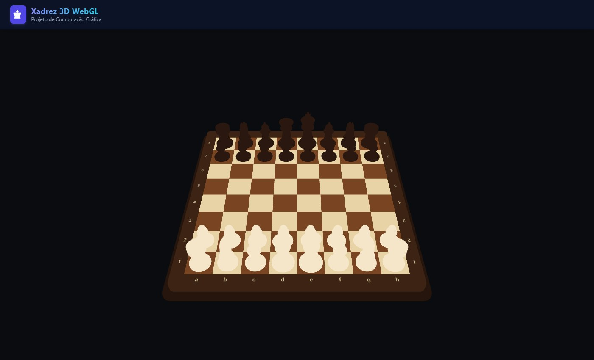

# ♟️ Xadrez 3D em WebGL2


Segunda entrega do jogo de xadrez 3D da disciplina de **Computação Gráfica**: **câmeras, projeção
perspectiva e iluminação**. A cena da Entrega 1 (tabuleiro e 32 peças na posição inicial) agora é vista
por uma câmera com duas posições e iluminada por três fontes de luz, que podem ser ligadas e desligadas
pelo teclado.


## Controles

| Tecla | Ação |
| --- | --- |
| `C` | Alterna a câmera entre o lado das brancas e o lado das pretas |
| `1` | Liga/desliga a luz ambiente |
| `2` | Liga/desliga a luz principal |
| `3` | Liga/desliga a luz de preenchimento |

Todo o código desta entrega está em [`src/graphics/chess-scene.js`](src/graphics/chess-scene.js).

## Cena 3D

Os modelos da Entrega 1 continuam os mesmos: o tabuleiro (casas, moldura com coordenadas e base) e as
32 peças modeladas por revolução (`LatheGeometry`), com o cavalo como personagem complexo. A cena
representa um tabuleiro sobre uma mesa em um ambiente escuro, iluminado de cima.

## Câmeras

A câmera tem **duas posições**, uma atrás de cada jogador, sempre olhando para o centro do tabuleiro:

| Posição | Coordenadas | Visão |
| --- | --- | --- |
| Lado das brancas (inicial) | `(0, 12, 12)` | brancas na frente, pretas ao fundo |
| Lado das pretas | `(0, 12, −12)` | pretas na frente, brancas ao fundo |

A tecla **`C`** chama `flipCamera()`, que inverte o sinal de `z` da câmera, aponta-a de novo para a
origem (`lookAt`) e redesenha a cena.

| Lado das brancas | Lado das pretas |
| --- | --- |
|  |  |

## Projeção perspectiva

A cena usa uma `THREE.PerspectiveCamera`. Nos prints acima dá para ver o efeito da perspectiva:

- **Objetos próximos parecem maiores:** as peças da fileira mais perto da câmera aparecem bem maiores
  que as do fundo, embora tenham o mesmo tamanho no mundo 3D. Ao trocar de câmera, as mesmas peças
  invertem de tamanho na tela.
- **Linhas paralelas convergem:** as bordas laterais do tabuleiro, que são paralelas, se aproximam no
  fundo, e o tabuleiro quadrado aparece como um trapézio; as casas do fundo ficam mais estreitas e
  mais baixas.

Onde a matriz de projeção aparece no código ([`chess-scene.js`](src/graphics/chess-scene.js)):

| Etapa | Linha | O que faz |
| --- | --- | --- |
| Definição | [28](src/graphics/chess-scene.js#L28) | `new THREE.PerspectiveCamera(45, 1, 0.1, 1000)`: campo de visão vertical de 45°, proporção da tela e planos *near* (0,1) e *far* (1000) |
| Cálculo | [75](src/graphics/chess-scene.js#L75) | `camera.updateProjectionMatrix()`: monta a matriz 4 × 4 em `camera.projectionMatrix` com a proporção atual da tela (largura ÷ altura) |
| Aplicação | [79](src/graphics/chess-scene.js#L79) | `renderer.render(scene, camera)`: o Three.js envia a matriz ao vertex shader de cada material, que calcula `gl_Position = projectionMatrix * modelViewMatrix * vec4(position, 1.0)` |

## Iluminação

As peças e o tabuleiro passaram a usar `MeshStandardMaterial` (material PBR que reage à luz). São
**três fontes de luz**, criadas em `_addLights()`:

| Tecla | Luz | Tipo | Cor e intensidade | Posição | Papel na cena |
| --- | --- | --- | --- | --- | --- |
| `1` | Ambiente | `AmbientLight` | branca, 0,7 | — | Clareia tudo por igual, sem direção; evita que o lado sem luz fique preto |
| `2` | Principal | `DirectionalLight` | branca, 0,8 | `(8, 15, 8)` | Luz forte do alto, do lado das brancas, como um lustre sobre a mesa; dá volume às peças |
| `3` | Preenchimento | `DirectionalLight` | azulada (`#90e0ef`), 0,3 | `(−8, 10, −8)` | Luz fraca do lado oposto, que suaviza o lado escuro deixado pela principal |

Cada tecla chama `toggleLight(nome)`, que alterna `light.visible` e redesenha a cena. Desligando as
outras duas, dá para ver a contribuição de cada uma sozinha:

| Só ambiente (`2` e `3` desligadas) | Só principal (`1` e `3` desligadas) | Só preenchimento (`1` e `2` desligadas) |
| --- | --- | --- |
|  |  |  |

- **Ambiente:** as peças ficam chapadas, sem sombreamento, porque a luz chega igual de todas as
  direções; só se vê a silhueta.
- **Principal:** aparecem o volume e o brilho especular; o lado das peças voltado para a luz é claro e o
  oposto fica escuro.
- **Preenchimento:** a cena fica escura e levemente azulada, iluminada do lado das pretas.

Com as três ligadas, a soma das luzes poderia estourar as cores claras em branco; por isso o renderer
usa *tone mapping* ACES (`renderer.toneMapping = THREE.ACESFilmicToneMapping`), que comprime a faixa de
brilho para a tela.

## Evolução em relação à Entrega 1

| Entrega 1 | Entrega 2 |
| --- | --- |
|  |  |

| Aspecto | Entrega 1 | Entrega 2 |
| --- | --- | --- |
| Câmera | Perspectiva, fixa do lado das brancas | Perspectiva, com duas posições alternadas pela tecla `C` |
| Projeção | Usada sem destaque | Identificada e comentada no código (definição, cálculo e aplicação) |
| Luzes | Nenhuma | Ambiente, principal e preenchimento, cada uma ligável pelas teclas `1`, `2` e `3` |
| Materiais | `MeshBasicMaterial` (cor pura, ignora a luz) | `MeshStandardMaterial` (PBR, com rugosidade) nas peças e no tabuleiro |
| Renderização | Desenha só ao redimensionar | Desenha também ao trocar a câmera ou ligar/desligar uma luz; *tone mapping* ACES |
| Interação | Nenhuma | Teclado (`C`, `1`, `2`, `3`) |

Arquivos alterados: [`chess-scene.js`](src/graphics/chess-scene.js) (câmera, luzes, teclado e *tone
mapping*), [`board-view.js`](src/graphics/board-view.js) e
[`pieces-view.js`](src/graphics/pieces-view.js) (troca de material). Os modelos
([`piece-geometry.js`](src/graphics/piece-geometry.js)) e a leitura da posição inicial não mudaram.

## Tecnologia

**Three.js r128 sobre WebGL2**, com módulos ES nativos e `importmap` (sem build). Todos os modelos
foram feitos em código pelo grupo; nenhum modelo externo foi usado.

## Como executar

O projeto não tem build nem dependências, mas usa **módulos ES nativos** e carrega bibliotecas por CDN
(é preciso estar online).

1. Abra a pasta do projeto no VS Code.
2. Instale a extensão **Live Server** (`ritwickdey.liveserver`).
3. Clique com o botão direito em `index.html` → **Open with Live Server**.
4. Clique na página e use as teclas `C`, `1`, `2` e `3`.

> Abrir o `index.html` com duplo clique (`file://`) **não funciona**: os navegadores bloqueiam módulos ES
> carregados de arquivos locais.

## Estrutura do projeto

```
.
├── index.html              # Página, área do canvas e importmap do Three.js
├── assets/                 # Favicon e prints
└── src/
    ├── main.js             # Ponto de entrada: monta a cena com a posição inicial
    ├── core/               # Dados do tabuleiro (sem Three.js nem DOM)
    │   ├── constants.js    #   cores das peças e convenção de coordenadas
    │   └── position.js     #   leitura da posição inicial (FEN)
    ├── graphics/           # Camada 3D (Three.js)
    │   ├── chess-scene.js  #   renderer, câmera (2 posições), luzes e teclado
    │   ├── board-view.js   #   tabuleiro, moldura, base e coordenadas
    │   ├── pieces-view.js  #   coloca cada peça na sua casa
    │   ├── piece-geometry.js # modelos das peças (revolução e extrusão)
    │   └── support.js      #   detecção de WebGL2
    └── config/skins.js     # Cores das peças e do tabuleiro
```
