# ♟️ Xadrez 3D em WebGL2


Terceira entrega do jogo de xadrez 3D da disciplina de **Computação Gráfica**: **mapeamento de
texturas**. O tabuleiro e as peças agora são de madeira: cinco imagens são aplicadas às casas, à moldura,
à base e às peças, com coordenadas UV calculadas para a textura acompanhar a geometria sem esticar. As
câmeras e as três luzes da Entrega 2 continuam funcionando sobre os objetos texturizados.

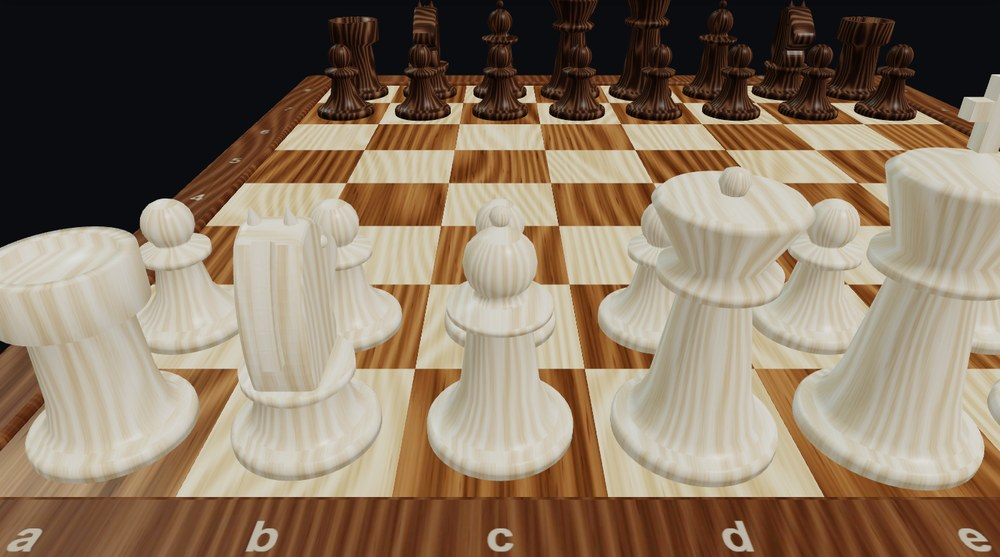

> Os prints de perto foram feitos com uma câmera de teste, fora do jogo. Durante a execução, as câmeras
> disponíveis são as duas descritas em [Câmeras](#câmeras).

## Controles

| Tecla | Ação |
| --- | --- |
| `C` | Alterna a câmera entre o lado das brancas e o lado das pretas |
| `1` | Liga/desliga a luz ambiente |
| `2` | Liga/desliga a luz principal |
| `3` | Liga/desliga a luz de preenchimento |

## Texturas

São **cinco imagens** de madeira (1024 × 1024 px), todas em [`assets/textures/`](assets/textures):

| Casas claras | Casas escuras | Moldura e base | Peças brancas | Peças pretas |
| --- | --- | --- | --- | --- |
| 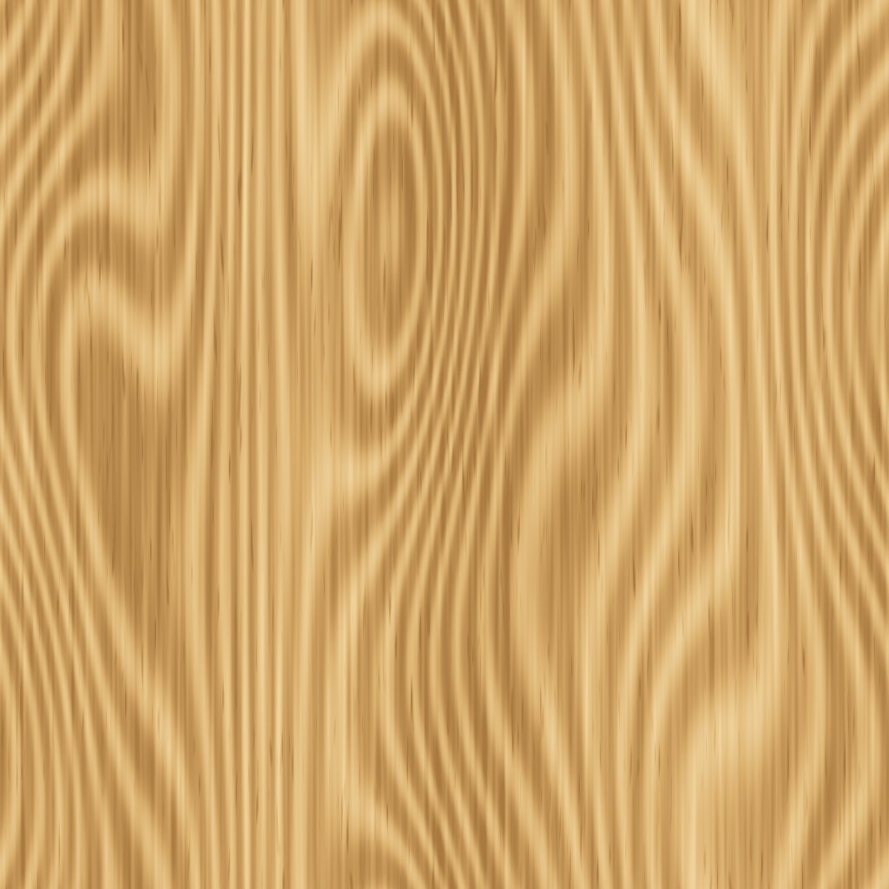 | 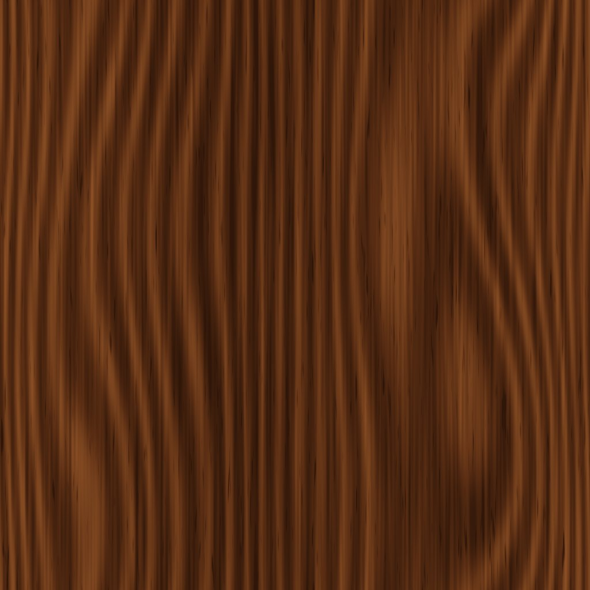 | 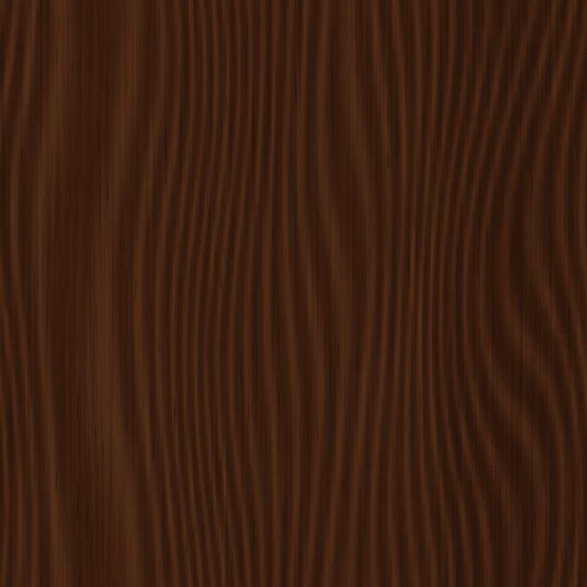 | 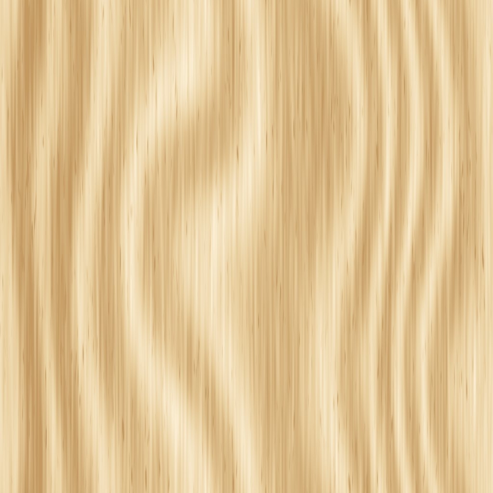 | 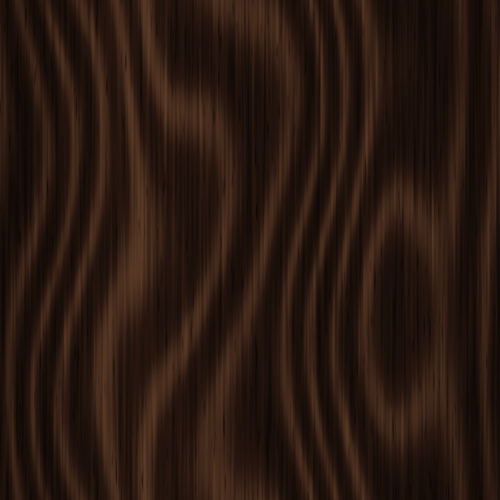 |
| `casa-clara.jpeg` | `casa-escura.jpeg` | `moldura.jpeg` | `peca-clara.jpeg` | `peca-escura.jpeg` |


No código, [`textures.js`](src/graphics/textures.js) carrega a imagem e ativa a repetição
(`RepeatWrapping`), e [`skins.js`](src/config/skins.js) define qual imagem vai em cada objeto. Como as
imagens chegam em segundo plano, a cena só é desenhada quando todas terminam de carregar.

## Coordenadas de textura (UV)

Cada vértice guarda um par `(u, v)`, que indica qual ponto da imagem ele mostra. Nas peças, 1 unidade de
UV corresponde a 1 imagem inteira e a 1 unidade do mundo (a largura de uma casa), para os veios terem
a mesma escala em todos os objetos. As coordenadas usadas em cada modelo são:

| Modelo | Geometria | u | v | Código |
| --- | --- | --- | --- | --- |
| Corpo das peças, laterais | `LatheGeometry` | voltas em torno do eixo × 2 | comprimento percorrido ao longo do perfil | [`lathe`](src/graphics/piece-geometry.js#L45) |
| Corpo das peças, tampas (faces quase horizontais) | `LatheGeometry` | `x` | `z` | [`lathe`](src/graphics/piece-geometry.js#L45) |
| Cabeça do cavalo, faces | `ExtrudeGeometry` | `x` da silhueta | `y` da silhueta | [`projectUV`](src/graphics/piece-geometry.js#L72) |
| Bordas da cabeça, orelhas, olhos, crina e cruz do rei | várias | plano mais alinhado à face | plano mais alinhado à face | [`projectUV`](src/graphics/piece-geometry.js#L72) |
| Casas | `BoxGeometry` | `(u₀ + coluna + 0,37 · linha) / 4` | `(v₀ + linha + 0,61 · coluna) / 4` | [`squareGeometry`](src/graphics/board-view.js#L44) |
| Moldura e base | `ExtrudeGeometry` | `x` do contorno × 0,25 | `y` do contorno × 0,25 | [`applySkin`](src/graphics/board-view.js#L139) |
| Coordenadas a–h e 1–8 | `PlaneGeometry` | 0 a 1 (padrão) | 0 a 1 (padrão) | `CanvasTexture`, da Entrega 1 |

Nas casas, `u₀` e `v₀` são os valores padrão da caixa, de 0 a 1. Dividir por 4 faz cada casa mostrar 1/4
da largura e da altura da imagem, e o deslocamento pela posição faz cada casa mostrar um trecho diferente
da madeira.

## Texturas e objetos

O cavalo, nosso personagem complexo, recebe a textura em todas as partes:

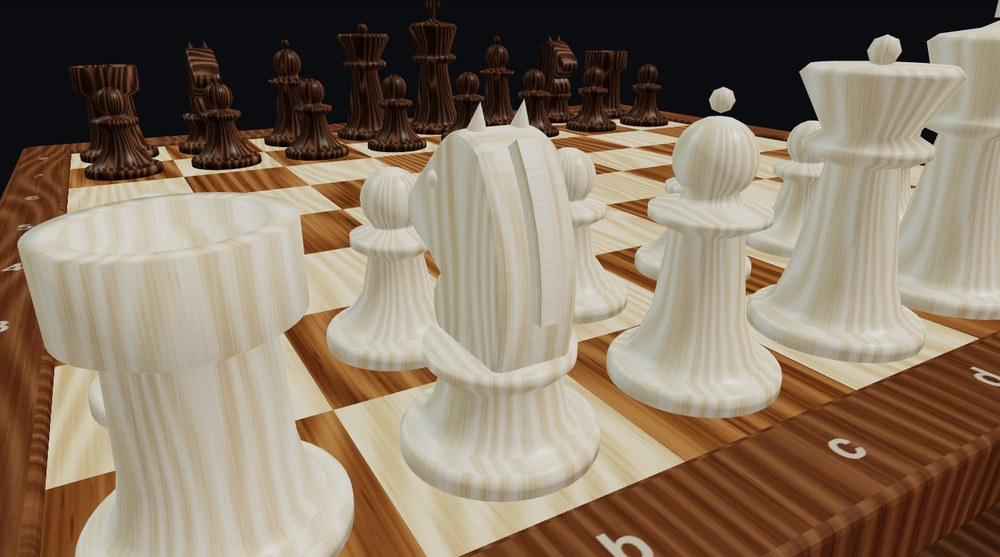

## Câmeras

A câmera tem **duas posições**, uma atrás de cada jogador, sempre olhando para o centro do tabuleiro:

| Posição | Coordenadas | Visão |
| --- | --- | --- |
| Lado das brancas (inicial) | `(0, 12, 12)` | brancas na frente, pretas ao fundo |
| Lado das pretas | `(0, 12, −12)` | pretas na frente, brancas ao fundo |

A tecla **`C`** chama `flipCamera()`, que inverte o sinal de `z` da câmera, aponta-a de novo para a
origem (`lookAt`) e redesenha a cena.

| Lado das brancas | Lado das pretas |
| --- | --- |
| 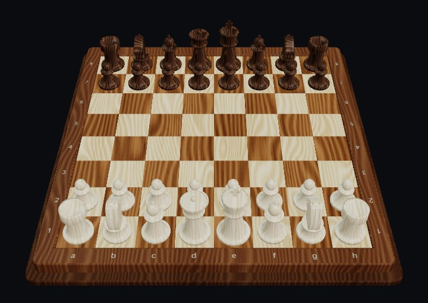 | 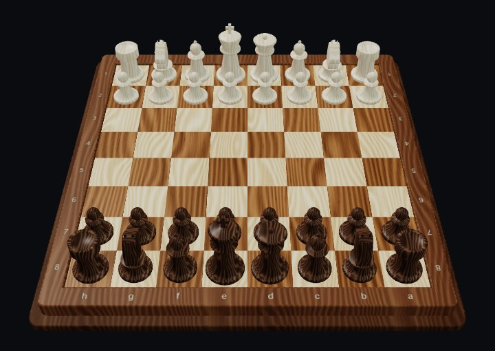 |

## Projeção perspectiva

A cena usa uma `THREE.PerspectiveCamera`. As peças mais próximas da câmera aparecem maiores que as do
fundo e as bordas paralelas do tabuleiro convergem, como mostram os prints acima.

| Etapa | Linha | O que faz |
| --- | --- | --- |
| Definição | [28](src/graphics/chess-scene.js#L28) | `new THREE.PerspectiveCamera(45, 1, 0.1, 1000)`: campo de visão vertical de 45°, proporção da tela e planos *near* (0,1) e *far* (1000) |
| Cálculo | [82](src/graphics/chess-scene.js#L82) | `camera.updateProjectionMatrix()`: monta a matriz 4 × 4 em `camera.projectionMatrix` com a proporção atual da tela |
| Aplicação | [86](src/graphics/chess-scene.js#L86) | `renderer.render(scene, camera)`: o Three.js envia a matriz ao vertex shader de cada material, que calcula `gl_Position = projectionMatrix * modelViewMatrix * vec4(position, 1.0)` |

## Iluminação sobre as texturas

As **três fontes de luz** da Entrega 2 foram mantidas, sem alterações:

| Tecla | Luz | Tipo | Cor e intensidade | Posição |
| --- | --- | --- | --- | --- |
| `1` | Ambiente | `AmbientLight` | branca, 0,7 | — |
| `2` | Principal | `DirectionalLight` | branca, 0,8 | `(8, 15, 8)` |
| `3` | Preenchimento | `DirectionalLight` | azulada (`#90e0ef`), 0,3 | `(−8, 10, −8)` |

Agora a imagem define a cor da superfície em cada ponto, no lugar de uma cor única, e o
`MeshStandardMaterial` calcula a luz sobre essa cor. Por isso os veios continuam visíveis e mudam de
aparência conforme a luz:

| Só ambiente (`2` e `3` desligadas) | Só principal (`1` e `3` desligadas) | Só preenchimento (`1` e `2` desligadas) |
| --- | --- | --- |
| 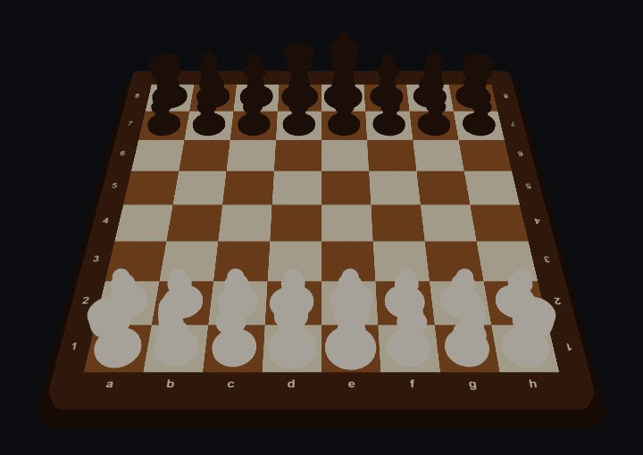 | 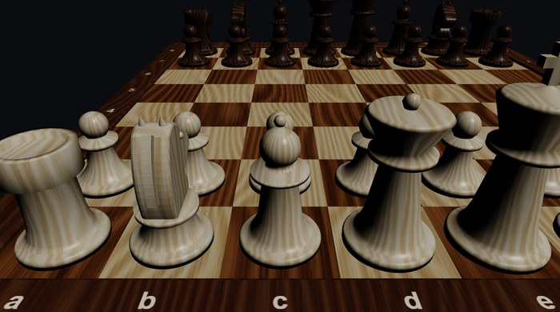 | 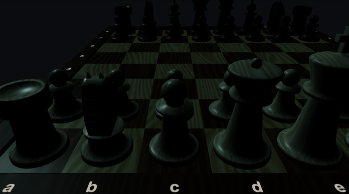 |

- **Ambiente:** os veios aparecem por igual, mas as peças ficam chapadas, sem volume.
- **Principal:** os veios aparecem junto com o volume e o brilho. O lado voltado para a luz mostra a
  madeira clara, e no lado oposto a textura escurece até sumir.
- **Preenchimento:** com pouca luz, a madeira fica escura e azulada, e os veios mal aparecem. Isso mostra
  que a cor final é a da textura combinada com a cor da luz.

Com as três ligadas, dá para perceber ao mesmo tempo a textura e os efeitos de luz. O *tone mapping* ACES
da entrega anterior continua comprimindo o brilho para a tela.

## Evolução em relação à Entrega 2

| Entrega 2 | Entrega 3 |
| --- | --- |
| 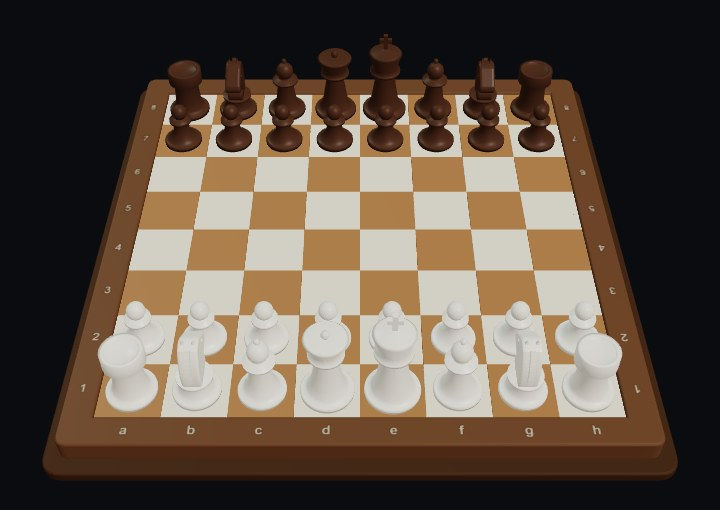 |  |

| Aspecto | Entrega 2 | Entrega 3 |
| --- | --- | --- |
| Superfícies | Cor única por material | Cinco imagens de madeira, uma para cada tipo de objeto |
| Coordenadas UV | Nenhuma usada nas peças e nas casas | Recalculadas para cada modelo |
| Casas | Todas iguais dentro de cada cor | Cada uma mostra um trecho diferente da madeira |
| Carregamento | Cena desenhada logo de início | Cena desenhada depois que as imagens carregam |
| Câmeras e luzes | Duas posições e três luzes | Sem alterações |

Arquivos alterados:

- [`textures.js`](src/graphics/textures.js) (novo): carrega as imagens e ativa a repetição.
- [`piece-geometry.js`](src/graphics/piece-geometry.js): calcula o UV das peças, sem mudar a forma delas.
- [`board-view.js`](src/graphics/board-view.js): calcula o UV das casas e aplica as texturas no tabuleiro.
- [`pieces-view.js`](src/graphics/pieces-view.js): aplica as texturas nas peças.
- [`skins.js`](src/config/skins.js): as cores das peças e do tabuleiro deram lugar às imagens.
- [`chess-scene.js`](src/graphics/chess-scene.js): espera as imagens carregarem antes de desenhar.

## Tecnologia

**Three.js r128 sobre WebGL2**, com módulos ES nativos e `importmap` (sem build). Todos os modelos foram
feitos em código pelo grupo; nenhum modelo externo foi usado.

## Como executar

O projeto não tem build nem dependências, mas usa **módulos ES nativos** e carrega bibliotecas por CDN
(é preciso estar online).

1. Abra a pasta do projeto no VS Code.
2. Instale a extensão **Live Server** (`ritwickdey.liveserver`).
3. Clique com o botão direito em `index.html` → **Open with Live Server**.
4. Clique na página e use as teclas `C`, `1`, `2` e `3`.

> Abrir o `index.html` com duplo clique (`file://`) **não funciona**: os navegadores bloqueiam módulos ES
> carregados de arquivos locais.

## Estrutura do projeto

```
.
├── index.html              # Página, área do canvas e importmap do Three.js
├── assets/                 # Favicon e prints
│   └── textures/           # Imagens usadas como textura
└── src/
    ├── main.js             # Ponto de entrada: monta a cena com a posição inicial
    ├── core/               # Dados do tabuleiro (sem Three.js nem DOM)
    │   ├── constants.js    #   cores das peças e convenção de coordenadas
    │   └── position.js     #   leitura da posição inicial (FEN)
    ├── graphics/           # Camada 3D (Three.js)
    │   ├── chess-scene.js  #   renderer, câmera (2 posições), luzes e teclado
    │   ├── board-view.js   #   tabuleiro, moldura, base, coordenadas e UV das casas
    │   ├── pieces-view.js  #   coloca cada peça na sua casa
    │   ├── piece-geometry.js # modelos das peças (revolução e extrusão) e UV
    │   ├── textures.js     #   carrega as imagens de textura
    │   └── support.js      #   detecção de WebGL2
    └── config/skins.js     # Texturas e cores do tema
```
