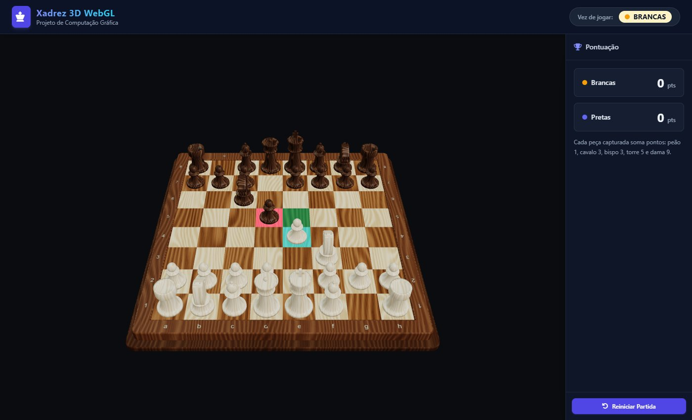
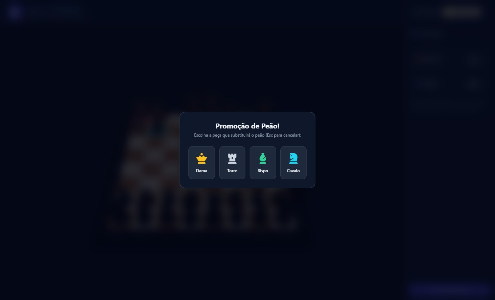
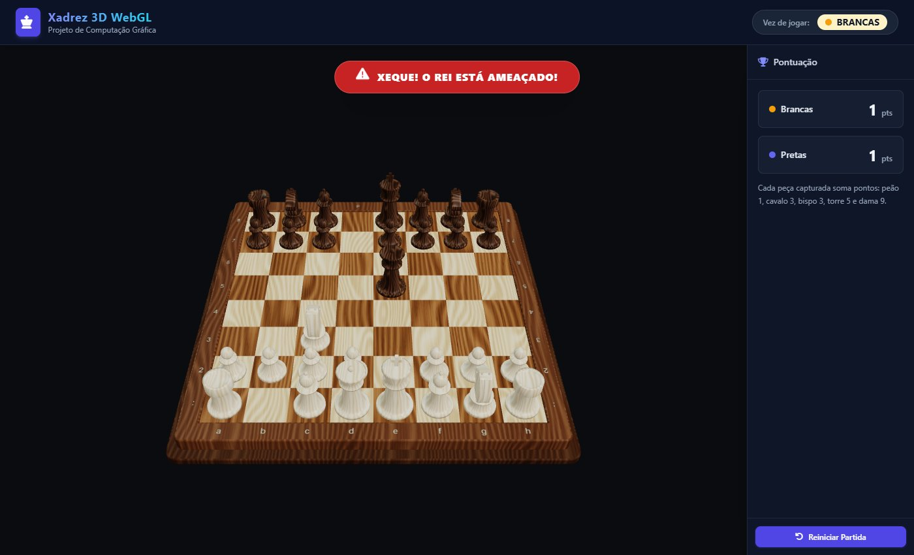
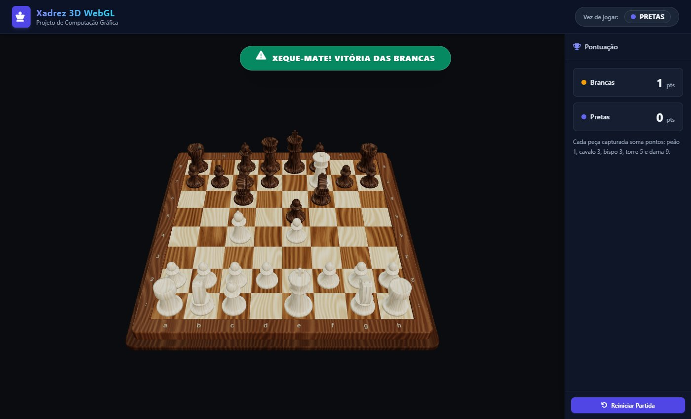

# ♟️ Xadrez 3D em WebGL2


Quarta entrega do jogo de xadrez 3D da disciplina de **Computação Gráfica**: **jogabilidade**. Agora
dá para jogar uma partida completa, com dois jogadores no mesmo computador: as peças são escolhidas com
o mouse direto na cena 3D, todas as regras do xadrez são aplicadas, as capturas valem pontos e a partida
termina com xeque-mate ou empate. O tabuleiro, as texturas, as câmeras e as luzes das entregas anteriores
continuam iguais.



## Controles

| Controle | Ação |
| --- | --- |
| Clique em uma peça da vez | Seleciona a peça e mostra para onde ela pode ir |
| Clique em uma casa destacada | Move a peça (ou captura a peça adversária que está lá) |
| Clique em outra peça da vez | Troca a seleção |
| Clique em qualquer outra casa | Desfaz a seleção |
| Botão **Reiniciar Partida** | Volta para a posição inicial e zera a pontuação |
| `Esc` (na janela de promoção) | Cancela a promoção e mantém o peão selecionado |
| `C` | Alterna a câmera entre o lado das brancas e o lado das pretas |
| `1`, `2`, `3` | Liga/desliga a luz ambiente, a principal e a de preenchimento |

## Movimentação e ações

O jogador controla as **peças da sua cor**, uma por vez, alternando com o adversário. As ações possíveis
são as do xadrez:

| Ação | Como acontece no jogo |
| --- | --- |
| Mover | Cada peça anda do seu jeito (peão, cavalo, bispo, torre, dama e rei) |
| Atacar (capturar) | Mover para a casa de uma peça adversária a retira do tabuleiro |
| Roque | Clicar no rei e depois na casa a duas colunas: rei e torre se movem juntos |
| En passant | O peão captura o peão adversário que acabou de avançar duas casas ao seu lado |
| Promoção | O peão que chega à última fileira vira dama, torre, bispo ou cavalo, à escolha do jogador |

Para os controles responderem de forma clara, a casa da peça selecionada fica **azul**, os destinos
livres ficam **verdes** e os destinos com captura ficam **vermelhos** (print acima). A cor de destaque
multiplica a textura da casa e um brilho (`emissive`) é somado por cima, então a madeira continua visível
([`setHighlights`](src/graphics/board-view.js#L161)). Um clique em uma casa que não é destino legal não
move nada.

Na promoção, uma janela pergunta qual peça o jogador quer:



## Interações e detecção de colisão

- **Clique na cena 3D (raycasting):** o ponto clicado é convertido para coordenadas normalizadas (de −1
  a 1) e o `THREE.Raycaster` lança um raio da câmera por esse ponto. A primeira peça ou casa atingida é a
  mais próxima da câmera, e a sua coordenada `(x, z)` vai para o jogo
  ([`_pickSquare`](src/graphics/chess-scene.js#L138)). Clicar na peça ou na casa dela dá no mesmo.
- **Colisão entre peças no tabuleiro:** bispo, torre e dama deslizam casa a casa e param na primeira
  peça do caminho; se ela for adversária, a casa dela entra como captura
  ([`slideMoves`](src/core/position.js#L246)). Nenhuma peça para em uma casa ocupada por outra da mesma
  cor, e só o cavalo pula por cima das outras.
- **Ameaça ao rei:** a partir da casa do rei, o jogo procura peças adversárias que o atacam (peões e
  cavalos próximos, peças de longo alcance na mesma linha, coluna ou diagonal)
  ([`isAttacked`](src/core/position.js#L135)). Isso decide o xeque e também quais lances são permitidos.

## Regras do jogo

As regras ficam em [`src/core/`](src/core), que não usa Three.js nem o DOM: a cena 3D só desenha o que o
núcleo validou.

- As brancas começam e os jogadores se alternam.
- Só são aceitos **lances legais**: o lance não pode deixar o próprio rei em xeque
  ([`generateLegalMoves`](src/core/position.js#L360)).
- Roque só se o rei e a torre nunca se moveram, sem peças entre eles e sem o rei passar por casa atacada
  ([`castlingMoves`](src/core/position.js#L268)).
- En passant só no lance logo após o avanço duplo do peão adversário.

Cada acontecimento tem uma consequência:

| Acontecimento | Consequência |
| --- | --- |
| Lance legal | A peça muda de casa e a vez passa para o adversário |
| Captura | A peça capturada sai do tabuleiro e o capturador ganha os pontos dela |
| Xeque | Alerta vermelho **"XEQUE! O REI ESTÁ AMEAÇADO!"** e só lances que salvam o rei ficam disponíveis |
| Xeque-mate ou empate | A partida acaba, o resultado fica na tela e o tabuleiro para de aceitar lances |



## Sistema de pontuação

O objetivo do xadrez é dar xeque-mate, e capturar peças é o caminho para isso. Por isso cada jogador soma
o **valor das peças que capturou**, com os valores tradicionais do xadrez
([`PIECE_VALUES`](src/core/constants.js#L24)):

| Peão | Cavalo | Bispo | Torre | Dama | Rei |
| --- | --- | --- | --- | --- | --- |
| 1 | 3 | 3 | 5 | 9 | — (nunca é capturado) |

A pontuação é calculada a partir dos lances jogados ([`score`](src/core/game.js#L73)) e atualizada no
painel **Pontuação**, à direita, depois de cada lance. No print acima, cada lado capturou um peão
(1 × 1). Ela serve de placar da partida, mas **não decide o vencedor**: quem dá xeque-mate vence mesmo
com menos pontos.

## Objetivo e fim da partida

| Resultado | Quando acontece | Indicação na tela |
| --- | --- | --- |
| Vitória (e derrota do adversário) | Xeque-mate: o rei está em xeque e não há lance que o salve | **XEQUE-MATE! VITÓRIA DAS BRANCAS** (ou **DAS PRETAS**), em verde |
| Empate por afogamento | O jogador da vez não tem lance legal, mas não está em xeque | **EMPATE POR AFOGAMENTO!**, em laranja |
| Empate por material insuficiente | Nenhum lado tem peças para dar mate (ex.: rei contra rei) | **EMPATE: MATERIAL INSUFICIENTE** |
| Empate pela regra dos 50 lances | 50 lances de cada lado sem captura nem movimento de peão | **EMPATE: REGRA DOS 50 LANCES** |
| Empate por tripla repetição | A mesma posição aparece três vezes | **EMPATE: TRIPLA REPETIÇÃO** |

O alerta de fim de jogo fica fixo na tela e o tabuleiro não aceita mais lances
([`_computeStatus`](src/core/game.js#L92)). O botão **Reiniciar Partida** volta para a posição inicial,
com a pontuação zerada e a vez das brancas ([`reset`](src/app/controller.js#L80)).



> Simplificação: a regra dos 50 lances e a tripla repetição encerram a partida automaticamente (no
> xadrez oficial, o jogador precisa pedir o empate).

## Das entregas anteriores

- **Modelos (Entrega 1):** peças feitas por revolução (`LatheGeometry`) e cabeça do cavalo por extrusão.
- **Câmeras, projeção e luzes (Entrega 2):** `PerspectiveCamera` com duas posições (tecla `C`) e três
  luzes que podem ser ligadas e desligadas (`1`, `2`, `3`).
- **Texturas (Entrega 3):** cinco imagens de madeira em [`assets/textures/`](assets/textures), com UV
  calculado para cada modelo.

## Evolução em relação à Entrega 3

| Aspecto | Entrega 3 | Entrega 4 |
| --- | --- | --- |
| Interação | Só teclado (câmera e luzes) | Clique nas peças e casas por raycasting |
| Peças | Paradas na posição inicial | Movem e capturam conforme as regras |
| Regras | Nenhuma | Xadrez completo: lances legais, roque, en passant, promoção, xeque, mate e empates |
| Interface | Só a cena 3D | Vez de jogar, pontuação, alertas, janela de promoção e botão de reiniciar |

Arquivos novos e alterados:

- [`game.js`](src/core/game.js) (novo): partida, pontuação e fim de jogo.
- [`position.js`](src/core/position.js) e [`constants.js`](src/core/constants.js): geração de lances,
  xeque, roque, en passant e valores das peças.
- [`controller.js`](src/app/controller.js) (novo): liga os cliques às regras e atualiza a cena e o painel.
- [`hud.js`](src/ui/hud.js) e [`promotion-modal.js`](src/ui/promotion-modal.js) (novos): painel e janela de
  promoção.
- [`chess-scene.js`](src/graphics/chess-scene.js): clique com raycasting.
- [`board-view.js`](src/graphics/board-view.js) e [`skins.js`](src/config/skins.js): destaque das casas.
- [`pieces-view.js`](src/graphics/pieces-view.js): marca as peças para o raycasting.
- [`index.html`](index.html) e [`main.js`](src/main.js): painel, alertas e montagem do jogo.

## Tecnologia

**Three.js r128 sobre WebGL2**, com módulos ES nativos e `importmap` (sem build). Tailwind CSS e Font
Awesome vêm por CDN para o painel. Todos os modelos foram feitos em código pelo grupo; nenhum modelo
externo foi usado.

## Como executar

O projeto não tem build nem dependências, mas usa **módulos ES nativos** e carrega bibliotecas por CDN
(é preciso estar online).

1. Abra a pasta do projeto no VS Code.
2. Instale a extensão **Live Server** (`ritwickdey.liveserver`).
3. Clique com o botão direito em `index.html` → **Open with Live Server**.
4. Clique em uma peça branca para começar a partida.

> Abrir o `index.html` com duplo clique (`file://`) **não funciona**: os navegadores bloqueiam módulos ES
> carregados de arquivos locais.

## Estrutura do projeto

```
.
├── index.html              # Página, painel (vez, pontuação, reiniciar), alertas e importmap
├── assets/                 # Favicon e prints
│   └── textures/           # Imagens usadas como textura
└── src/
    ├── main.js             # Ponto de entrada: monta o jogo
    ├── core/               # Regras do xadrez (sem Three.js nem DOM)
    │   ├── constants.js    #   cores, coordenadas e valor das peças
    │   ├── position.js     #   posição (FEN), lances legais, xeque, roque, en passant
    │   └── game.js         #   partida: lances, pontuação e fim de jogo
    ├── graphics/           # Camada 3D (Three.js)
    │   ├── chess-scene.js  #   renderer, câmera, luzes, teclado e clique (raycasting)
    │   ├── board-view.js   #   tabuleiro, coordenadas, UV das casas e destaques
    │   ├── pieces-view.js  #   coloca cada peça na sua casa
    │   ├── piece-geometry.js # modelos das peças (revolução e extrusão) e UV
    │   ├── textures.js     #   carrega as imagens de textura
    │   └── support.js      #   detecção de WebGL2
    ├── ui/                 # Interface 2D (DOM)
    │   ├── hud.js          #   vez de jogar, pontuação e alertas
    │   └── promotion-modal.js # janela de escolha da promoção
    ├── app/controller.js   # Liga regras, cena 3D e interface
    └── config/skins.js     # Texturas, cores do tema e cores de destaque
```
